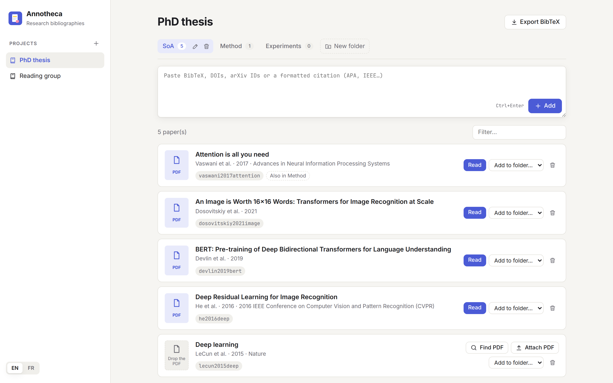
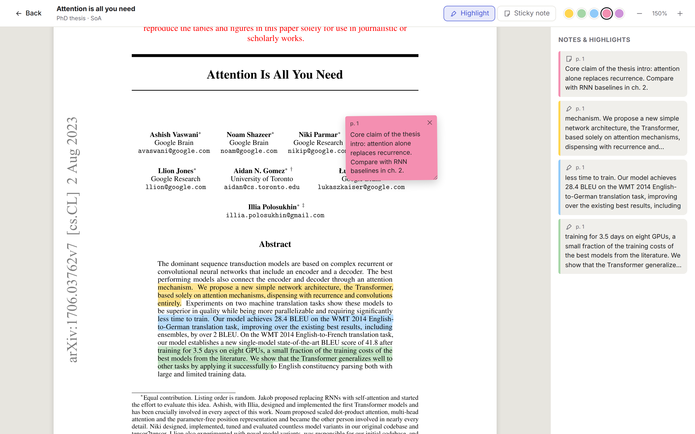
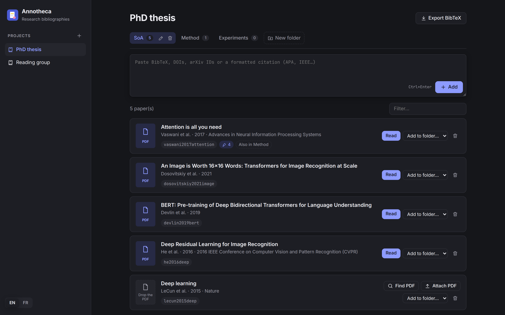

<p align="center">
  
</p>

<h1 align="center">Annotheca</h1>

<p align="center">
  <b>A calm, local home for the bibliography of your research projects.</b><br>
  Paste a reference, get the BibTeX and the PDF, highlight, take notes, export one clean <code>.bib</code>.
</p>

<p align="center">
  
</p>

## Why

Research projects live in stages (state of the art, method, experiments,
writing) and the same paper often matters in several of them, for different
reasons. Annotheca organises references the way the project is organised:

- **Projects and stage folders.** Every project starts with a `SoA` (state of
  the art) folder; add as many folders as your project has stages.
- **Paste anything.** BibTeX (one or many entries), DOIs, arXiv IDs or URLs,
  or a formatted citation copied from a paper (APA, IEEE, ...). Annotheca
  resolves it into clean BibTeX through doi.org, arXiv and Crossref.
- **PDFs found for you.** Open-access PDFs are downloaded automatically from
  arXiv and Semantic Scholar. Otherwise, drop the PDF on the paper.
- **Highlights and sticky notes.** Highlight passages in five colours and pin
  draggable post-its on the page.
- **One paper, several folders, separate notes.** A paper filed in two folders
  is stored once, but its highlights and notes are specific to each folder:
  what you underline for the state of the art is not what you underline for
  the method.
- **One clean `.bib`.** Export the whole project in one click; papers filed in
  several folders appear only once, with stable, unique citation keys.
- **English and French**, light and dark themes, everything stored locally.

<p align="center">
  
</p>

## Install

Annotheca needs Python 3.10 or newer. Install it as a command with
[uv](https://docs.astral.sh/uv/) or [pipx](https://pipx.pypa.io/):

```sh
uv tool install git+https://github.com/melissa-colin/annotheca
# or
pipx install git+https://github.com/melissa-colin/annotheca
```

## Use

```sh
annotheca
```

The interface opens in your browser at <http://127.0.0.1:8737>. Running the
command again while Annotheca is running simply reopens it.

| Option | Effect |
| --- | --- |
| `--port PORT` | Serve on another local port (default `8737`). |
| `--data-dir DIR` | Keep the library somewhere else. |
| `--no-browser` | Do not open the browser. |

Tips:

- `Ctrl+Enter` adds what you pasted.
- Click a citation key to copy `\cite{key}`.
- Drop a PDF file on a paper to attach it.
- In the reader, select text to highlight it; switch to *Sticky note* and
  click on the page to pin a note; click a highlight to recolour or delete it;
  `Esc` goes back.

## Your data

Everything stays on your machine, in `~/.local/share/annotheca` (or
`$XDG_DATA_HOME/annotheca`, or `$ANNOTHECA_HOME`):

```
library.db   SQLite database: projects, folders, BibTeX, annotations
pdfs/        one PDF per paper
```

Back it up by copying that directory. The only network requests are the
lookups of references and PDFs, sent to doi.org, arXiv, Crossref and Semantic
Scholar.

<p align="center">
  
</p>

## Development

```sh
git clone https://github.com/melissa-colin/annotheca
cd annotheca
uv venv && uv pip install -e '.[test]'
.venv/bin/pytest
.venv/bin/annotheca --data-dir /tmp/annotheca-dev
```

The code follows the Google Python and JavaScript style guides. The backend is
a small [FastAPI](https://fastapi.tiangolo.com/) app over SQLite
(`src/annotheca`); the interface is dependency-free JavaScript modules with
[pdf.js](https://mozilla.github.io/pdf.js/) vendored, so there is no build
step.

```
src/annotheca/
  cli.py       command line entry point
  api.py       HTTP API and static files
  library.py   storage: projects, folders, papers, placements, annotations
  bibtex.py    BibTeX parsing, formatting, citation keys, identifiers
  sources.py   doi.org, arXiv, Crossref and Semantic Scholar lookups
  static/      web interface
```

## License

MIT. pdf.js is distributed under the Apache License 2.0
(`src/annotheca/static/vendor/pdfjs/LICENSE`).
